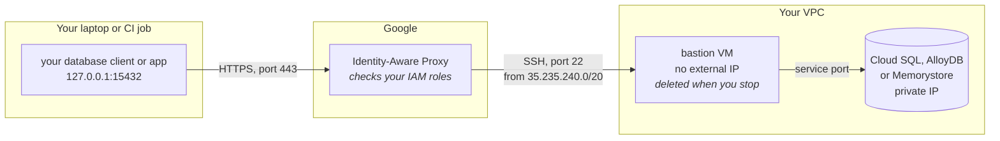

<p align="center">
  
</p>

<h1 align="center">bqto</h1>

<p align="center">Reach private Google Cloud services from your laptop or a CI job, through a short-lived bastion.</p>

<p align="center">
  <a href="https://github.com/pilef-co/bqto/actions/workflows/ci.yml"></a>
  <a href="https://github.com/pilef-co/bqto/releases/latest"></a>
  <a href="LICENSE"></a>
</p>

<p align="center">
  <a href="https://bqto.dev">Website</a> ·
  <a href="#quickstart">Quickstart</a> ·
  <a href="docs/usage.md">Documentation</a> ·
  <a href="docs/troubleshooting.md">Troubleshooting</a> ·
  <a href="https://github.com/pilef-co/bqto-action">GitHub Action</a> ·
  <a href="https://bqto.dev/#waitlist">bqto Pro beta</a>
</p>

bqto works with Cloud SQL, AlloyDB and Memorystore. You do not need a VPN or a
bastion that runs all the time.

## How it works

Your client connects to a local port. bqto carries the traffic through
Identity-Aware Proxy (IAP) and a temporary bastion VM to the service's private
address.



1. bqto asks the service's API for its private address.
2. bqto checks that the firewall lets IAP reach port 22, then creates a small
   bastion VM in the service's network, with no external IP.
3. bqto opens an IAP tunnel and forwards a local port through the bastion to
   the service.
4. When you stop, bqto deletes the bastion. If it cannot, a deadline set on the
   VM deletes it.

[docs/usage.md](docs/usage.md#how-a-session-works) explains each step.

## What it looks like

```text
$ bqto connect --project my-project --service cloudsql --instance orders-db
checking auth…
resolving endpoint…
checking firewall…
finding zones…
finding subnet…
creating bastion from debian-13-trixie-v20261027…
bastion bqto-410ded5f is in us-east1-b
opening tunnel…
ready: 127.0.0.1:15432 → 10.0.0.5:5432 (instance orders-db), bastion bqto-410ded5f, expires at 00:38 (in 29m)
try: psql "host=127.0.0.1 port=15432 user=postgres"
^C
deleting bastion…
bastion bqto-410ded5f is being deleted (about 2 minutes)
```

## Quickstart

1. Install bqto:

   ```sh
   curl -fsSL https://raw.githubusercontent.com/pilef-co/bqto/main/install.sh | sh
   ```

   Or, with Homebrew: `brew install pilef-co/tap/bqto`.

2. Sign in to Google Cloud:

   ```sh
   gcloud auth login
   gcloud auth application-default login
   ```

3. Ask an admin for the roles in [Permissions](#permissions), and for the APIs
   and the firewall rule in [Requirements](#requirements).

4. Connect:

   ```sh
   bqto connect --project my-project --service cloudsql --instance my-db
   ```

Without flags, bqto starts a wizard.

You can also let a coding agent do this. Install the skill below.

## Use with a coding agent

An agent skill teaches Claude Code, Codex, Cursor and other coding agents to
open a bqto session. Install it for every agent on this machine:

```sh
npx skills add pilef-co/bqto -g
```

[docs/usage.md](docs/usage.md#coding-agents) explains what the command installs
and how to copy the skill by hand.

## Use in GitHub Actions

[pilef-co/bqto-action](https://github.com/pilef-co/bqto-action) runs a step
against a private service from a workflow, for example a database migration.
It needs no service account key and no runner inside the VPC:

```yaml
- uses: pilef-co/bqto-action@v1
  with:
    project: my-project
    instance: my-db
    run: ./migrate up
```

[The action's README](https://github.com/pilef-co/bqto-action#readme) lists the
inputs and shows the setup.

## Services

| Service | `--service` | Plan |
|---|---|---|
| Cloud SQL, including read replicas | `cloudsql` | Free |
| AlloyDB, including read pools | `alloydb` | Free |
| Memorystore for Redis, Basic and Standard tiers | `redis` | Free |
| Memorystore for Valkey, cluster mode disabled | `valkey` | Free |
| Memorystore for Redis Cluster | `redis` | [bqto Pro](#bqto-pro) |
| Memorystore for Valkey in cluster mode | `valkey` | [bqto Pro](#bqto-pro) |
| Managed Kafka | `kafka` | [bqto Pro](#bqto-pro) |
| Cloud Run, internal ingress | `cloudrun` | [bqto Pro](#bqto-pro) |

## Requirements

- macOS or Linux, on amd64 or arm64.
- The [Google Cloud CLI](https://cloud.google.com/sdk/docs/install) on `PATH`,
  version 550.0.0 or later.
- An SSH client (`ssh`) on `PATH`.
- A target service with a private IP, through private services access (PSA) or
  Private Service Connect (PSC). bqto refuses a target service that has only a
  public IP.
- A subnet in the target service's region and VPC network where a VM can run.
- These APIs enabled in the target service's project:

  ```sh
  gcloud services enable compute.googleapis.com cloudresourcemanager.googleapis.com \
    iap.googleapis.com oslogin.googleapis.com sqladmin.googleapis.com --project PROJECT
  ```

  Replace `sqladmin.googleapis.com` with `alloydb.googleapis.com` for AlloyDB,
  `redis.googleapis.com` for Redis or `memorystore.googleapis.com` for Valkey.
  [docs/permissions.md](docs/permissions.md#apis) says what each one is for.
- A firewall rule or policy that allows ingress on tcp:22 from `35.235.240.0/20`
  (the IAP range) into the target service's VPC network.

## Permissions

| Where | For | Roles |
|---|---|---|
| Service project | Finding the service | The viewer role of the service, such as `roles/cloudsql.viewer` |
| Service project | Creating and deleting the bastion | `roles/compute.instanceAdmin.v1` |
| Service project | SSH through IAP | `roles/iap.tunnelResourceAccessor`, `roles/compute.osLogin` |
| Network project (Shared VPC host, or the same project) | Subnet and firewall checks | `roles/compute.networkViewer` |
| Network project, Shared VPC only | Using the subnet | `roles/compute.networkUser` on the subnet |

`roles/compute.instanceAdmin.v1` is broad: it can manage every VM in the
project and gives sudo on all of them. The
[minimal custom role](docs/permissions.md#a-minimal-custom-role) holds only what
bqto uses.

If you use `roles/editor` instead of the roles above, add
`roles/iap.tunnelResourceAccessor` as well.

[docs/permissions.md](docs/permissions.md) has every role and the commands to
grant them. [docs/security.md](docs/security.md) is for your security team.

## Build and install

[install.sh](install.sh) downloads the newest release for your machine, checks
its SHA-256 against the release's `checksums.txt` and puts `bqto` in
`/usr/local/bin`:

```sh
curl -fsSL https://raw.githubusercontent.com/pilef-co/bqto/main/install.sh | sh
```

`BQTO_VERSION=v0.16.0` installs that release, and `BQTO_INSTALL_DIR=~/.local/bin`
installs into another folder.

With Homebrew:

```sh
brew install pilef-co/tap/bqto
```

[docs/usage.md](docs/usage.md#install-by-hand) shows how to install a release
archive by hand.

### Upgrade

`bqto update` installs the newest release.
[docs/usage.md](docs/usage.md#update) has the details.

### Shell completion

`bqto completion bash`, `bqto completion zsh` or `bqto completion fish` prints a
completion script. [docs/usage.md](docs/usage.md#shell-completion) shows how to
turn it on.

### Uninstall

Delete the `bqto` binary. [docs/usage.md](docs/usage.md#cleanup-and-uninstall)
lists the files that a session can leave behind.

### Build from source

With Go 1.26 or later:

```sh
go install github.com/pilef-co/bqto/cmd/bqto@latest
```

Or, from a checkout:

```sh
go build -o bqto ./cmd/bqto
./bqto version
```

To work on bqto itself, see [CONTRIBUTING.md](CONTRIBUTING.md).

## Cleanup

A session deletes its bastion VM when it ends.
[docs/usage.md](docs/usage.md#cleanup-and-uninstall) lists what can stay behind
and [who created a bastion](docs/usage.md#who-created-a-bastion).

## Troubleshooting

When a check or the tunnel fails, bqto prints the cause and a `Fix:` line.
[docs/troubleshooting.md](docs/troubleshooting.md) matches each tunnel error to
its fix and explains `--debug`.

## Getting help

Open an issue at https://github.com/pilef-co/bqto/issues with the output of the
failing command run with `--debug`. Check it for project names first. To report
a vulnerability, follow [SECURITY.md](SECURITY.md) instead.

## Documentation

- [docs/usage.md](docs/usage.md): how a session works, flags, shell completion,
  scripts and CI, exit codes, cleanup and updates.
- [docs/troubleshooting.md](docs/troubleshooting.md): tunnel errors and debug
  output.
- [docs/permissions.md](docs/permissions.md): every role, and how to grant it.
- [docs/security.md](docs/security.md): data flows, credentials and the audit
  trail.
- [docs/design.md](docs/design.md): the problem, why a VM hop is required and
  where bqto stops being the right tool.
- [CHANGELOG.md](CHANGELOG.md): what changed in each release.

## bqto Pro

bqto Pro is the paid build of bqto, now in beta. To try it, join the bqto Pro
beta at https://bqto.dev/#waitlist. It is one `bqto` binary that does everything
this one does. It adds:

- Cloud Run services with internal ingress, through a SOCKS5 proxy or a local
  web proxy (`--web`).
- Managed Kafka, Memorystore for Redis Cluster and Memorystore for Valkey in
  cluster mode, through the same SOCKS5 proxy.
- Profiles and stacks (`bqto profile`, `bqto stack`, `--profile`, `--stack`,
  `--save`, `--replace`).
- `--spot`, `--subnet`, `--machine-type` and `--image`, for organizations that
  restrict what a VM may be.
- `--endpoint IP:PORT`, to connect to a private IP and port instead of a named
  target service.

Examples from `bqto profile -h`:

```sh
bqto connect --project P --service cloudsql --instance orders --save db
bqto profile create cache --project P --service redis --instance cache
bqto connect db
bqto stack create work --profile db --profile cache
bqto connect --stack work
```

This binary marks the bqto Pro flags `(bqto Pro)` in its help, and refuses them
with exit code 2.

## License

bqto is licensed under the [Apache License 2.0](LICENSE). bqto Pro is a
separate product with its own terms.

bqto is not affiliated with or endorsed by Google. Google Cloud, Cloud SQL,
AlloyDB, Memorystore and Cloud Run are trademarks of Google LLC. Other names are
trademarks of their owners.
