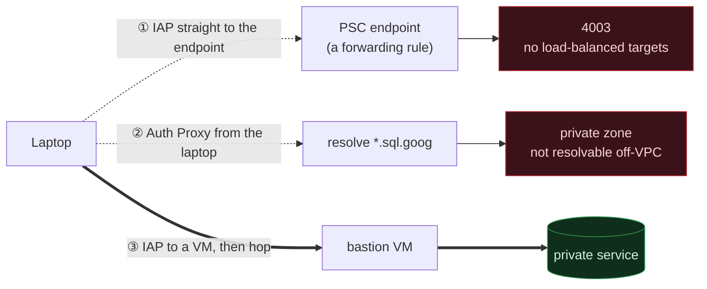

# Why bqto works this way

This page explains the problem that bqto solves, why it needs a VM between the
laptop and the service, and where it stops being the right tool. It is for
readers who want to judge whether bqto fits their case.

## The problem

Today, a developer who wants to reach a private-IP service inside a VPC from a
laptop has these choices:

- A VPN to maintain.
- An overlay network like Tailscale to install and operate.
- A standing bastion that somebody has to patch and remember.
- Cloud Interconnect.

All of them are permanent infrastructure, and most are too much when you want
to run one query.

bqto is the minimal version, with no standing infrastructure at all. A VM exists
for the length of a session and is then gone.

### What it avoids

bqto needs no VPN. Nobody maintains a gateway, hands out client configuration,
debugs a split tunnel or renews anything.

bqto needs no overlay network. Laptops get no Tailscale or WireGuard agent, and
the data path has no extra identity system and no third party.

bqto needs no standing bastion. A permanent jump host is a permanent attack
surface: it needs patching, it collects stale SSH keys and it usually outlives
the person who created it. A bastion VM that lives for one session is a smaller
target and cannot be forgotten.

Google handles authentication and authorization. Identity-Aware Proxy (IAP)
checks IAM at connection time, so you grant and revoke access with existing
roles, and it appears in existing audit logs. The role is
`roles/iap.tunnelResourceAccessor`, which IAM conditions can scope by
destination port but not by VM name. You have no second set of credentials to
issue or revoke.

A session costs little: one VM for 30 minutes. bqto Pro adds `--spot`, which is
cheaper but can be preempted.

Nothing has a public IP. bqto creates the bastion with `--no-address`. Access
comes only from IAP's `35.235.240.0/20` range, with an IAM identity.

## Why a VM hop is required

A tunnel cannot go straight to the service, so bqto creates a VM:

- IAP TCP forwarding cannot terminate on a Private Service Connect (PSC)
  endpoint. It supports Compute Engine VMs only. It "doesn't support
  load-balanced targets", and a PSC endpoint is a forwarding rule. A tunnel
  aimed at one fails with `4003: failed to connect to backend`, even when firewall and IAM are correct.
- IAP cannot reach a Cloud SQL private IP either. A tunnel destination group
  (`gcloud compute start-iap-tunnel --dest-group`) aimed at the instance's
  private IP fails with the same `4003: failed to connect to backend` (tested
  2026-10-14). The instance sits behind VPC peering.
- Cloud SQL Auth Proxy cannot bridge into the VPC. It is an auth and TLS layer,
  not a transport: it "does not provide a new connectivity path; it relies on
  existing IP connectivity." It must already run inside the VPC.

Google has an open issue for this use case:
[cloud-sql-proxy#2158](https://github.com/GoogleCloudPlatform/cloud-sql-proxy/issues/2158),
"How to use the cloud-sql-auth proxy with Private Service Connect from developer
machines". It has been open since March 2024 and is now a feature request. A
maintainer proposed a target-IP override, which nobody implemented.



Paths ① and ② are what people usually try first. Only ③ works, and the extra
hop is the reason bqto creates a VM.

### What the hop can reach

Once the hop exists, anything with a private IP in the VPC is reachable: Cloud
SQL, Memorystore, AlloyDB, internal load balancers, private endpoints and
services on VMs. IAP can only terminate on a VM, so every service type needs
the hop.

## Verified end to end

On 2026-09-16, the manual equivalent ran against a real project and reached
both services from a laptop:

```text
Valkey  PING -> +PONG
Valkey  GET  -> hello          (SET from bastion, GET from laptop)
Postgres TLS -> TLSv1.3, SASL/SCRAM auth requested
```

Postgres stopped at the auth challenge only because the test supplied no
password. The server accepted TLS and asked for SCRAM, which exercises the full
path.

## Scope

bqto is for interactive use, such as psql, valkey-cli or a local client against
a forwarded port, and for transfers of a few gigabytes.

The numbers below were measured on 2026-10-14 in us-central1, against Cloud SQL
for PostgreSQL 17 (db-f1-micro, private IP). The VM is an `e2-standard-2` in
us-central1-a. The laptop is a Mac on a home line that macOS `networkQuality`
put at 46 Mbps down.

The server generates 1 GB and sends it:

| From | Path | Bastion | Runs | 1 GB |
|---|---|---|---|---|
| VM | direct, no tunnel | none | 2 | 9.2 and 9.7 s (about 105 MB/s) |
| VM | through bqto | `e2-standard-2` | 1 | 14.5 s (69 MB/s) |
| Laptop | through bqto | `e2-micro` (default) | 4 | 2.1 to 2.4 min (7 to 8 MB/s) |
| Laptop | through bqto | `e2-standard-2` | 1 | 2.75 min (6 MB/s) |

One `select 1`, 20 in a row on one connection:

| From | Path | Bastion | One query |
|---|---|---|---|
| VM | direct, no tunnel | none | 0.33 to 1.0 ms, about 0.4 ms |
| VM | through bqto | `e2-micro` (default) | 6 to 19 ms, about 10 ms |
| Laptop | through bqto | `e2-micro` (default) | 148 to 165 ms, about 150 ms |

From the VM, the tunnel carried about 550 Mbps, so IAP is not a hard limit at
laptop speeds. From the laptop, it gave 6 to 8 MB/s (48 to 64 Mbps), close to
that line's single speed reading, and a bigger bastion did not help. These runs
cannot tell whether the line or one TCP connection at 150 ms was the limit. Two
of the four `e2-micro` laptop runs had NumPy installed for gcloud and were no
faster. Google suggests NumPy for upload speed, which these runs did not
measure.

Through the SOCKS proxy of bqto Pro (`e2-micro` bastion), a 30 MiB response from
a Cloud Run service with internal ingress took 0.65 to 1.03 s from the VM
(3 runs) and 5.5 to 7.3 s from the laptop (3 runs). Direct from the VM, with no
tunnel, it took 1.25 s (1 run, probably including the service's cold start).

How it was measured, with the `PG*` connection variables set and bqto Pro for
`--machine-type`:

```sh
export Q="copy (select repeat('x',1000) from generate_series(1,1000000)) to stdout"
time psql -c "$Q" | wc -c    # 1001000000 bytes
bqto connect --service cloudsql --project P --instance NAME \
  --machine-type TYPE --duration 20m -- bash -c 'time psql -c "$Q" | wc -c'
(echo "\timing on"; for i in $(seq 20); do echo "select 1;"; done) | psql -At | grep Time
```

bqto stops being the right tool in these cases:

- Bulk data. Google says IAP TCP forwarding "isn't intended for bulk transfer of
  data" and can rate-limit, with no published figure. A dump or restore of tens
  of gigabytes, or a Kafka consumer that reads a topic from the start, belongs
  inside GCP: on a VM in the VPC, with the data moved through Cloud Storage.
- Many small queries in a row. Each one pays the round trip through IAP and the
  bastion. Thousands of sequential queries feel it. Batch them, or run the job
  inside GCP.

IAP closes a tunnel after an hour with no traffic. bqto sends an SSH keepalive
every 30 seconds, so a quiet session does not look idle.
