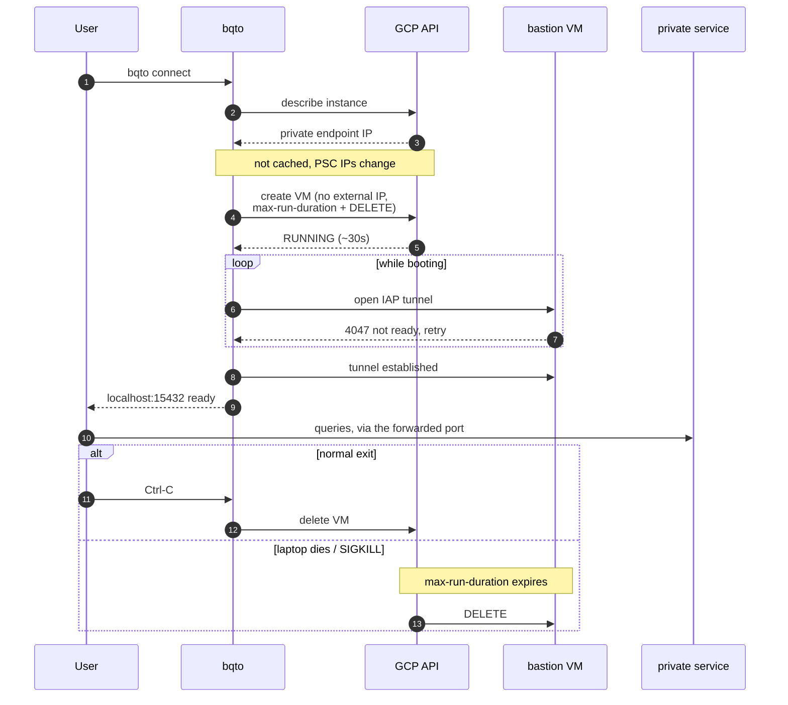

# Using bqto

Reference for flags, scripts, exit codes, cleanup and updates. The
[README](../README.md) has the install and the first connection.

## How a session works

A session has four steps:

1. bqto asks the service's API for its private endpoint.
2. bqto creates a bastion VM with no external IP.
3. bqto opens an IAP tunnel and forwards a local port to the endpoint.
4. bqto deletes the VM on exit. A server-side deadline deletes it if bqto
   cannot.

`--duration` (default `30m`) is the VM's lifetime, counted from when the VM
starts. The tunnel takes a minute or two to open, so the time you can use is a
little shorter. The `ready:` line shows when the session ends, and bqto warns
5 minutes before.

The tunnel can drop when the laptop sleeps, the network changes or IAP closes
the session. bqto then opens it again against the same bastion, while the VM is
still running and the session still has time. It waits longer between each
attempt. It gives up after five attempts in a row, or as soon as the bastion is
gone.

### Session lifecycle



The bastion has two independent ways to go away. bqto deletes it in ordinary
use. If the process is killed or the laptop dies, bqto cannot do that, so
Compute Engine deletes the VM when its `max-run-duration` ends.

## Requirements in detail

The [README](../README.md#requirements) lists the requirements. A few more
details:

- `gcloud auth login` and `gcloud auth application-default login` must use the
  same account. bqto checks it.
- Slim Linux images need `openssh-client` and `ca-certificates`.
- The network must allow outbound HTTPS with WebSockets to
  `tunnel.cloudproxy.app`.
- bqto checks for the firewall rule that lets IAP reach the bastion, but does
  not create it. A network admin can create one:

  ```sh
  gcloud compute firewall-rules create allow-iap-ssh \
    --project=NETWORK_PROJECT --network=NETWORK \
    --direction=INGRESS --action=ALLOW --rules=tcp:22 \
    --source-ranges=35.235.240.0/20
  ```

## Interface

bqto has an interactive wizard and flags.

Without flags, the wizard asks for the project, the service, the instance and the
session duration, in that order. The free binary keeps no configuration and no
credentials.

Flags skip the prompts, for returning users and scripts:

```sh
bqto connect --service cloudsql --project my-project --instance sql-main
bqto connect --service cloudsql --project my-project --instance sql-main -- sh -c 'psql -h "$PGHOST" -p "$PGPORT" -U app'
```

`bqto connect -h` lists every flag.

### Connecting

Give the service and the instance by name. bqto asks the service's API for the
private address, so it also knows the region and the network:

```sh
bqto connect --service cloudsql --project my-project --instance sql-main
bqto connect --service redis    --project my-project --instance europe-west1/cache
```

`--network` puts the bastion on another VPC than the instance's. It takes a
name, or `projects/HOST/global/networks/NAME` when the VPC lives in another
project (Shared VPC).

Then use the local port that the `ready:` line prints. The `try:` line gives a
command for the service's client:

```text
ready: 127.0.0.1:15432 → 10.0.0.5:5432 (instance sql-main), bastion bqto-13f6cae5, expires at 19:30 (in 6m)
try: psql "host=127.0.0.1 port=15432 user=postgres"
```

If the default port is taken, bqto says so and uses the next one. Read the
number from `ready:` instead of assuming it. bqto does not move a port that you
ask for with `-p`. If that port is taken, bqto stops before it creates the
bastion.

Wait for `ready:` (or the ready event of `--output json`) before you connect.

### Shell completion

`bqto completion` prints a script for bash (3.2 or later), zsh or fish. With
the script, Tab completes:

- The commands: `connect`, `completion`, `version`, `update`, `help`.
- The flags of `bqto connect`.
- The value after `--service` (the services this binary has) and after
  `--output` (`text`, `json`).

To turn completion on, add the line for your shell to its startup file and open
a new terminal.

Bash:

```sh
echo 'eval "$(bqto completion bash)"' >> ~/.bashrc
```

Zsh:

```sh
echo 'source <(bqto completion zsh)' >> ~/.zshrc
```

Fish:

```sh
echo 'bqto completion fish | source' >> ~/.config/fish/config.fish
```

On macOS, Terminal starts bash as a login shell, which reads `~/.bash_profile`
instead of `~/.bashrc`. Put the bash line there.

### In scripts and CI

When stdin is not a terminal, or with `--output json`, bqto does not prompt.
It acts as with `--no-input`: a missing value is an error.

With `-- CMD`, bqto runs the command once the tunnel is up and ends the session
when the command exits. The port follows the same rule as above, so two jobs on
one host can run at once. The command gets the port it actually has in its
environment:

| Variable | Value |
|---|---|
| `BQTO_HOST`, `BQTO_PORT` | `127.0.0.1` and the local port |
| `PGHOST`, `PGPORT` | the same, for Cloud SQL and AlloyDB |
| `BQTO_REMOTE` | the service's own address, `HOST:PORT`: the private IP the port forwards to |
| `BQTO_TLS` | `1` when your client must use TLS, empty otherwise |
| `BQTO_AUTH` | the credential the service takes: `password` (an AUTH string), `iam` (an access token), or empty for none |

```sh
bqto connect --service cloudsql --project my-project --instance sql-main \
  --no-input -- sh -c 'psql -U app -c "select 1"'
```

For a longer session, `--output json` prints one JSON object per service on
stdout once the tunnel is up. The object has the local host and port, the
service's own address (`remote`), whether your client must use TLS (`tls`), and
which credential it takes (`auth`: `password`, `iam` for an access token, or
empty). A script can start bqto in the background, read the line and stop bqto
with SIGINT or SIGTERM when it is done.

With `--end-on-stdin-close`, bqto ends the session when its stdin closes, for
example when the program that started it dies. It does not go with `-- CMD`.

```sh
bqto connect --end-on-stdin-close --output json \
  --project my-project --service cloudsql --instance my-db
```

An AI agent can drive bqto with the skill in
[skills/bqto/SKILL.md](../skills/bqto/SKILL.md).
[Coding agents](#coding-agents) shows how to install it.

### Exit codes

| Code | Meaning |
|---|---|
| 0 | The session ended normally once it was ready: Ctrl-C, SIGTERM, SIGHUP (the terminal closed), the end of stdin with `--end-on-stdin-close`, or its `--duration` ran out |
| 1 | An error: auth, an API call, the bastion, the tunnel, a session that ended early or a bastion that could not be deleted |
| 2 | A usage error: an unknown flag, a missing or bad value or a feature of [bqto Pro](../README.md#bqto-pro). Nothing was created |
| 126 | The command after `--` exists but cannot run, for example a script without `chmod +x`; checked before the bastion |
| 127 | The command after `--` was not found; checked before the bastion |
| 130 | Interrupted (SIGINT, SIGTERM, SIGHUP or the end of stdin with `--end-on-stdin-close`) before the session was ready, or the wizard was quit |
| 128 + N | With `-- CMD`, the command was killed by signal N: 143 for SIGTERM, 137 for SIGKILL |
| other | With `-- CMD`, the command's own exit code |

To run bqto from a GitHub Actions job, use
[bqto-action](https://github.com/pilef-co/bqto-action#readme).

## bqto Pro features in this binary

This binary lists the bqto Pro flags last in `bqto connect -h`, marked
`(bqto Pro)`. If you give it one of them, or a bqto Pro service or command, it
says bqto Pro is needed and stops before it prompts or creates anything. It
tells you what to do instead or to join the bqto Pro beta, and exits 2.

Help is the exception. `bqto -h` lists `bqto profile` and `bqto stack`, marked
`(bqto Pro)`. `bqto profile -h` or `bqto stack -h` shows what they do, with
examples, and exits 0.

## What the bastion can reach

The bastion reaches what any VM in the VPC reaches.
[security.md](security.md#what-a-developer-can-do) says how to limit it.

## Organizations that restrict what a VM may be

Some organization policies reject the bastion that bqto creates. bqto then
prints the constraint that refused it and where it is set, so you can pass both
to the platform team. [bqto Pro](../README.md#bqto-pro) adds `--image` for a
policy that allows only approved image projects. bqto cannot meet a policy that
requires CMEK or disallows global DNS. In that case, the fix asks for an
exception.

## Cleanup and uninstall

A session deletes its bastion when it ends: on Ctrl-C, when you close the
terminal, on `kill`, when `-- CMD` exits, or when `--duration` runs out. If the
delete fails, bqto says so on stderr. It exits 1, unless the command after `--`
already exited non-zero. In that case, bqto keeps the command's exit code.

These things can stay behind:

| What | Where | How to remove it |
|---|---|---|
| A bastion, if bqto was killed with `kill -9`, the laptop died or the delete failed, and the deadline has not passed yet | the project, labelled `bqto=session` | `gcloud compute instances list --filter=labels.bqto=session`, then `gcloud compute instances delete NAME --zone ZONE` |
| The SSH key gcloud made for the tunnel | `~/.ssh/google_compute_engine` and `.pub` | delete them; gcloud makes new ones when needed |
| The host key and the certificate of a bastion whose session was killed | `~/.ssh/google_compute_known_hosts`, `~/.ssh/google_compute_engine_cert/` | delete the `compute.ID` lines and the file; a session that ends normally removes its own |

To uninstall, delete the `bqto` binary and the files above. The
[install script](../install.sh) puts it in `/usr/local/bin`, or in the folder
you gave in `BQTO_INSTALL_DIR`. `go install` puts it in `$(go env GOPATH)/bin`.
`command -v bqto` shows where it is.

### Who created a bastion

The bastion name is `bqto-` plus eight random characters. It does not say who
ran the command, on purpose: anyone who can list instances would otherwise read
a colleague's email. The Admin Activity audit logs answer the question instead,
and Google always writes them:

```sh
gcloud logging read \
  'logName:"cloudaudit.googleapis.com%2Factivity"
   AND protoPayload.methodName="v1.compute.instances.insert"
   AND protoPayload.resourceName:"instances/bqto-"' \
  --project PROJECT --freshness 7d --limit 20 \
  --format='table(timestamp, protoPayload.authenticationInfo.principalEmail, protoPayload.resourceName.scope(instances))'
```

To ask about one bastion, add its name to `protoPayload.resourceName`. To see
who removed it, change `insert` to `delete`. The logs do not say who opened the
tunnel, who logged in or what they reached.

## Update

`bqto version` prints the version and asks GitHub for the latest release, with a
2-second limit. If a newer release exists, it says so on stderr:

```text
bqto v0.16.0
bqto 0.16.1 is available (you have 0.16.0).
Fix: bqto update
```

If the release fixes a security issue, the second line is
`bqto 0.16.1 fixes a security issue in your version.`

`bqto version --output json` prints
`{"version":"0.16.0","latest":"0.16.1","update_available":true,"security":false}`
and no notice. No other command looks for updates, and nothing runs in the
background. [security.md](security.md) says what is sent.

`bqto update` updates bqto only when you run it. What it does depends on how you
installed bqto:

- Installed with Homebrew, it runs `brew upgrade bqto`.
- Installed with `go install`, it runs
  `go install github.com/pilef-co/bqto/cmd/bqto@latest`.
- Otherwise, it downloads the newest release archive for your system and its
  `checksums.txt`, checks the SHA-256 and replaces the `bqto` binary that ran,
  following symlinks.

If the folder is not yours, such as `/usr/local/bin`, `bqto update` asks for
sudo.

## Install by hand

Download the archive for your machine from the release page, check it and put
`bqto` on your `PATH`:

```sh
gh release download --repo pilef-co/bqto --pattern 'bqto_*_darwin_arm64.tar.gz' --pattern checksums.txt
shasum -a 256 --ignore-missing -c checksums.txt
tar -xzf bqto_*_darwin_arm64.tar.gz bqto && sudo mv bqto /usr/local/bin/
```

On an Intel Mac, use `darwin_amd64`. On Linux, use `linux_amd64` or
`linux_arm64`. If GitHub limits the requests from your address, `install.sh`
takes a token: `curl … | GITHUB_TOKEN=$(gh auth token) sh`.

## Coding agents

The bqto skill, [skills/bqto/SKILL.md](../skills/bqto/SKILL.md), teaches a coding
agent to open a session without prompts, run its command through the tunnel and
read the `Fix:` lines.

To install it for every coding agent on this machine, use the
[skills](https://github.com/vercel-labs/skills) CLI:

```sh
npx skills add pilef-co/bqto -g
```

It installs the skill for every agent it finds. Drop `-g` to install it into
the current project. `npx skills update` installs a new version.

You can also copy the skill by hand from a checkout of this repository:

```sh
mkdir -p ~/.claude/skills/bqto ~/.agents/skills/bqto
cp skills/bqto/SKILL.md ~/.claude/skills/bqto/
cp skills/bqto/SKILL.md ~/.agents/skills/bqto/
```

Claude Code reads `~/.claude/skills/`. Codex and the other agents that use the
shared folder read `~/.agents/skills/`. `cp` replaces a `SKILL.md` that is
already there, edits included. The skill describes the bqto of the same
release, so after `bqto update`, copy or update it again.
